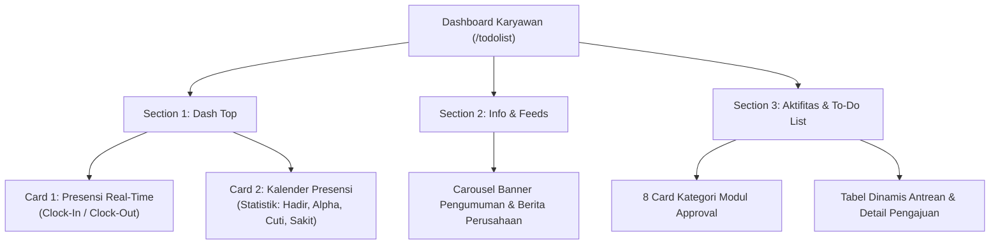
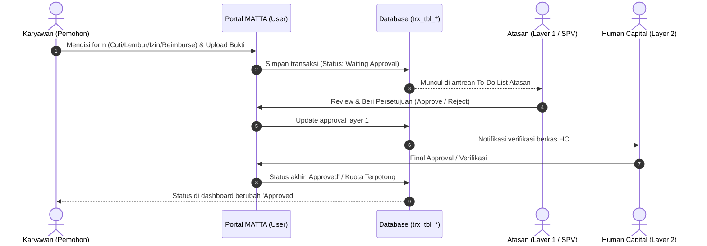

# DOKUMEN DESAIN SISTEM — PORTAL KARYAWAN (USER SIDE)
## MATTA Reborn — Enterprise Workplace & HRIS System
**PT Alita Praya Mitra**

---

## 1. Pendahuluan & Gambaran Umum

Dokumen ini menjelaskan arsitektur, antarmuka (UI/UX), modul fitur, alur kerja (workflow), serta integrasi database untuk **Portal Karyawan (User Side / Employee Self-Service)** pada sistem **MATTA Reborn**.

Portal Karyawan dirancang sebagai *single hub workplace* bagi seluruh insan ALITA untuk mengelola presensi harian, administrasi kepegawaian, pengajuan izin/cuti/lembur, pemantauan slip gaji, pengumuman internal perusahaan, hingga verifikasi kepatuhan regulasi data pribadi (PDP).

### Prinsip Desain Portal Pengguna:
- **Clean & Modern Workplace UI**: Berbasis layout modern dengan hierarki visual yang jelas, navigasi sidebar modular, serta aksen warna korporat (*corporate blue & vibrant orange*).
- **Responsive & Ergonomic**: Dirancang optimal untuk desktop kantor maupun perangkat layar kecil/laptop kerja.
- **Real-Time Data Integration**: Integrasi dua arah langsung (*two-way live integration*) antara tindakan pengguna dan database pusat yang terhubung dengan panel admin HC.
- **Fast Interactive Experience**: Validasi instan di sisi klien, lazy-loading data, caching opsi filter, dan detail modal/pop-up interaktif tanpa reload halaman yang berlebihan.

---

## 2. Arsitektur Hak Akses & Pengguna (User Roles)

Sistem menggunakan kontrol akses berbasis peran (Role-Based Access Control / RBAC) yang dikelola melalui tabel `mtr_tbl_karyawan` dan Laravel Gate/Middleware:

| Role Pengguna | Level Akses di Portal Karyawan | Lingkup Fitur |
|---|---|---|
| **Karyawan Reguler (`nhc`)** | Standard User | Presensi, Pengajuan Formulir Sendiri, Cek Status Approval Pribadi, Slip Gaji, Feeds |
| **Supervisor / Koordinator (`spv`)** | Approver Layer 1 | Seluruh fitur karyawan reguler + modul approval bawahan langsung (Training, Recruitment) |
| **Assistant Manager / Manager (`asm`)** | Approver Layer 2 | Seluruh fitur SPV + approval rekomendasi karyawan & penambahan tim (*Add Employees*) |
| **Human Capital (`hc` / `admin`)** | Full Administrative User | Akses penuh portal pengguna + tombol cepat navigasi (*switch pill*) menuju **HC Admin Portal** |

---

## 3. Struktur Layout Antarmuka (User Master Layout)

Layout utama pengguna diatur dalam [`layouts.matta.master`](file:///d:/coding/laragon/www/matta_dev/matta_dev/resources/views/layouts/matta/master.blade.php) yang membagi halaman menjadi tiga komponen esensial:

```
+-----------------------------------------------------------------------------------+
|  [Sidebar]               |  [App Header]                                         |
|  - Logo MATTA            |  - Toggle Sidebar  - Switch HC Admin  - ID/EN  - Profile |
|  - Navigasi Home         +-------------------------------------------------------+
|  - Applications (Forms)  |  [Main Content Area]                                  |
|  - Payroll               |  - Breadcrumbs & Dashboard                            |
|  - Attendance            |  - Interactive Widgets / Data Tables                  |
|  - Overtime              |                                                       |
|  - Logo TRUST Footer     |                                                       |
+-----------------------------------------------------------------------------------+
```

### A. Komponen Sidebar (`sidebar.blade.php`)
1. **Brand Identity**: Logo resmi MATTA dengan tombol *collapse/toggle*.
2. **Navigasi Beranda**:
   - `Home` (`/todolist`): Dasbor sentral aktivitas & approval.
   - `Feeds` (`/feeds`): Pusat berita & pengumuman resmi perusahaan.
3. **Menu Applications (Formulir Pengajuan)**:
   - Accordion dropdown berisi formulir: *Overtime, Evaluation, Leave, Permit, Exit Clearance, Reimbursement, Sick Leave, Health Form*.
4. **Menu Payroll**:
   - Tautan langsung menuju *Payroll Slip* mandiri dengan pengaman enkripsi URL.
5. **Menu Attendance**:
   - *Attendance Log* (Riwayat presensi harian).
   - *Attendance Recap* (Rekap kehadiran cut-off).
6. **Menu Overtime Propose**:
   - Akses instan pengajuan lembur tim.
7. **Sidebar Footer**:
   - Logo core values **TRUST** (*Truthful, Resilient, Unwavering, Sound, Teamwork*).

### B. Komponen Header (`header.blade.php`)
- **Tombol HC Admin**: Tampil khusus bagi personel HC untuk beralih instan antara mode Employee Self-Service dan HC Management Portal.
- **Language Switcher**: Pengalih bahasa dwibahasa (Bahasa Indonesia & English).
- **User Profile Capsule**: Menampilkan foto avatar karyawan, nama lengkap, dan NIP.
  - Dropdown menu berisi: *My Profile, Attendance Log, HC Admin Portal (conditional), dan Log Out (aman via CSRF POST)*.

---

## 4. Desain Halaman Utama (Dashboard — `/todolist`)

Halaman utama berfungsi sebagai pusat aktivitas harian karyawan yang menggabungkan presensi, kalender, berita, dan alur antrean persetujuan.



### A. Attendance Widget Card (Presensi Harian)
- **Jam Digital Real-time**: Menampilkan jam dan menit aktif (WIB) yang berdetak setiap detik.
- **Box Catatan Presensi**:
  - Menampilkan jam presensi yang tercatat pada hari berjalan.
  - Indikator status kehadiran (*Tepat Waktu*, *Toleransi*, atau *Terlambat*).
- **Tombol Presensi Dinamis (Clock-In / Clock-Out)**:
  - Sebelum presensi pagi: Tombol aktif untuk **Clock In**.
  - Setelah Clock In: Tombol terkunci hingga pukul **17:30 WIB** (sesuai aturan jam pulang kerja) sebelum tombol **Clock Out** dapat ditekan.
  - Setelah Clock Out: Tombol beralih menjadi status *Selesai / Presensi Lengkap*.

### B. Kalender Kehadiran & Rekap Mini
- **Mini Calendar Grid**: Tampilan kalender interaktif bulan berjalan dengan navigasi bulan sebelumnya/berikutnya.
- **Counter Statistik Bulanan**:
  - `Hadir` (Hijau): Akumulasi hari masuk kerja.
  - `Alpha` (Merah/Oranye): Jumlah ketidakhadiran tanpa keterangan.
  - `Cuti` (Biru): Jumlah hari cuti yang telah disetujui.
  - `Sakit` (Kuning/Amber): Jumlah hari izin sakit tercatat.

### C. Container Info & Pengumuman (Feeds Carousel)
- Menampilkan *card carousel* berita atau surat edaran perusahaan yang sedang aktif.
- Dilengkapi tombol navigasi slide, indikator titik (*dots*), dan link cepat *"Lihat Semua Feeds"*.

### D. Aktifitas Karyawan & To-Do List (Approval Queue)
Pusat manajemen persetujuan dokumen pengajuan. Menggunakan kartu bergrid interaktif yang ketika diklik akan langsung memfilter tabel antrean di bawahnya secara *real-time*:

1. **Card Overtime (Lembur)** — Menampilkan counter pengajuan lembur yang menunggu persetujuan.
2. **Card Evaluation (Evaluasi Kinerja)** — Pengajuan evaluasi berkala/probation karyawan.
3. **Card Leave (Cuti)** — Pengajuan cuti tahunan/khusus.
4. **Card Permit (Izin)** — Pengajuan izin keperluan pribadi, datang terlambat, pulang awal.
5. **Card Exit Clearance (Izin Keluar)** — Proses serah terima aset dan klirens divisi bagi karyawan resign/mutasi.
6. **Card Reimbursement (Pengembalian Biaya)** — Klaim penggantian biaya operasional/medis.
7. **Card Sick Leave (Izin Sakit)** — Pengajuan surat sakit & MC dokter.
8. **Card MORE / Konfirmasi** — Wadah pengajuan manajerial lainnya (Travel Expense / BPD, Pelatihan, Rekomendasi, Kebutuhan Karyawan, dsb.).

---

## 5. Modul Formulir Pengajuan Mandiri (Employee Self-Service Forms)

Seluruh formulir pengajuan memiliki standardisasi alur kerja (*standardized submission flow*):



### Rincian Modul Formulir:
1. **Formulir Cuti (`/formulir/cuti`)**:
   - Pilihan jenis cuti: Tahunan, Melahirkan, Ibadah, Cuti Bersama, Alasan Penting.
   - Pengecekan sisa kuota cuti secara otomatis.
   - Pemilihan tanggal mulai s/d tanggal selesai beserta alasan pengajuan.
2. **Formulir Lembur / Overtime (`/overtime/propose`)**:
   - Pemilihan tanggal lembur, jam mulai, dan jam selesai.
   - Pengisian rincian target/tugas pekerjaan lembur yang dikerjakan.
   - Rekomendasi uang makan & kompensasi lembur sesuai ketentuan perusahaan.
3. **Formulir Izin (`/formulir/izin`)**:
   - Kategori: Terlambat Hadir (*Late-in*), Pulang Awal (*Early-out*), atau Keluar Kantor Sementara.
   - Input jam izin dan alasan keperluan.
4. **Formulir Reimbursement (`/formulir/reimburse`)**:
   - Input nomor rekening & bank penerima.
   - Kategori biaya: Medis, Perjalanan Dinas, Operasional Lapangan.
   - Upload berkas bukti pembayaran / kuitansi resmi (PDF/JPG).
5. **Formulir Sakit (`/formulir/sakit`)**:
   - Input tanggal istirahat sakit.
   - Wajib melampirkan foto/scan Surat Keterangan Dokter (MC).
6. **Formulir Exit Clearance (`/formulir/nonaktif`)**:
   - Form serah terima inventaris kantor: Laptop/IT, Kendaraan dinas, Kartu Akses, Klirens Keuangan, dan Dokumen Divisi.

---

## 6. Desain Komprehensif Seluruh Tabel Pengguna (Data Table Specifications)

Portal Pengguna MATTA mengadopsi standar desain **Data Table Enterprise** yang seragam di seluruh modul. Setiap tabel dirancang dengan mempertimbangkan keterbacaan data (*legibility*), kecepatan pencarian, serta responsivitas terhadap berbagai resolusi layar.

### A. Standar Komponen & Anatomi Tabel

Setiap tabel di portal pengguna memiliki struktur antarmuka standar:

```
+-----------------------------------------------------------------------------------+
|  [Show (10/25/50/100) entries]            [Cari data...]   [Copy][CSV][Excel][PDF] |
+-----------------------------------------------------------------------------------+
|  No ▲ | Tanggal ▲ | Jam ▲ | Nama / NIP ▲ | Kolom Spesifik... | Aksi / Status      |
+-----------------------------------------------------------------------------------+
|  1    | 10-11-2026| 08:30 | Budi Santoso | ...               | [Badge Approved]   |
|  2    | 10-11-2026| 08:32 | Siti Rahma   | ...               | [Badge Waiting]    |
+-----------------------------------------------------------------------------------+
|  Menampilkan 1 sampai 10 dari 250 entri                    [Prev] [1] [2] [Next]  |
+-----------------------------------------------------------------------------------+
```

1. **Toolbar Atas**:
   - `Length Selector`: Pilihan batas baris per halaman (10, 25, 50, 100 entries).
   - `Live Search Input`: Penyaringan instan (*client-side & server-side filter*) di semua kolom tanpa reload.
   - `Export Action Buttons`: Tombol aksi instan untuk menyalin (*Copy*), unduh *CSV*, *Excel*, *PDF*, dan *Print*.
2. **Body & Typography Rules**:
   - **Teks Nama / Judul**: Font Inter / Plus Jakarta Sans, regular & semi-bold.
   - **Angka / Jam / NIP / Koordinat**: Font *monospaced* (`font-family: monospace` / class `.mono`) dengan rata tengah (*center*) agar angka sejajar secara vertikal.
   - **Sorting Header**: Setiap kolom utama memiliki indikator ikon panah dua arah (▲▼) untuk pengurutan ascending/descending.
3. **Footer**:
   - `Info Summary`: Informasi posisi data (e.g. *"Menampilkan 1 sampai 10 dari 150 entri"*).
   - `Pager / Pagination`: Navigasi halaman sebelumnya, nomor halaman, dan halaman berikutnya.

---

### B. Spesifikasi Tabel 1: Antrean Pengajuan & To-Do List (`/todolist`)

Tabel dinamis di bawah 8 Card Modul pada dashboard utama. Data pada tabel ini berubah otomatis sesuai kartu modul yang sedang aktif diklik:

| No | Nama Kolom Header | Tipe Data & Format | Alignment | Keterangan & Style |
|:--:|---|---|:--:|---|
| 1 | **ID** | String (`#OVT-102`, `#LVE-88`) | Center / Mono | Nomor tiket transaksi unik dengan prefix modul |
| 2 | **Formulir** | String (*Formulir Lembur, Cuti, dsb.*) | Left | Nama formulir pengajuan |
| 3 | **Lampiran** | Icon / String (`-` atau link file) | Center | Link unduh bukti pendukung/nota jika ada |
| 4 | **Nama Pemohon** | String | Left | Nama lengkap karyawan pemohon |
| 5 | **NIP** | Numeric (`01032510885`) | Center / Mono | Nomor Induk Pegawai pemohon |
| 6 | **Jabatan** | String (*Staff, Engineer, Lead*) | Left | Jabatan pemohon saat mengajukan |
| 7 | **Unit Kerja** | String (*ALITA, PT Anak Perusahaan*) | Left | Entitas perusahaan pemohon |
| 8 | **Tanggal** | Date (`d M Y`, e.g. `10 Nov 2026`) | Center | Tanggal pengajuan dibuat |
| 9 | **Jam** | Time (`H:i WIB`, e.g. `14:20 WIB`) | Center / Mono | Jam pengajuan dibuat |
| 10 | **Status** | Status Badge | Center | Badge status approval: `Waiting Approval` (oranye), `Approved` (hijau), `Rejected` (merah) |

---

### C. Spesifikasi Tabel 2: Log Presensi — Raw Data (`/attendance`)

Tabel riwayat rekaman presensi lengkap karyawan per hari:

| No | Kolom Header | Format / Contoh Data | Alignment | Keterangan Visual |
|:--:|---|---|:--:|---|
| 1 | **No** | Nomor urut (`1, 2, 3...`) | Center | Dihitung otomatis per halaman |
| 2 | **Tanggal** | Date (`10-11-2026`) | Center | Tanggal kalender presensi |
| 3 | **Jam** | Time (`08:30:15`) | Center / Mono | **Jam presensi saja** (`H:i:s`), semi-bold. *(Status dihapus sesuai kebutuhan)* |
| 4 | **Nama** | String + Subtitle Divisi | Left | Nama karyawan di baris 1, nama departemen di baris 2 |
| 5 | **NIP** | Numeric (`01032510885`) | Center / Mono | Nomor Induk Pegawai |
| 6 | **ID_FP** | Numeric (`99`) / `-` | Center / Mono | ID karyawan pada mesin fingerprint fisik |
| 7 | **Perusahaan** | String (*PT Alita Praya Mitra*) | Left | Entitas legal perusahaan |
| 8 | **Direktorat** | String (*Operation*) | Left | Direktorat organisasi |
| 9 | **Divisi** | String (*Information Technology*) | Left | Divisi organisasi |
| 10 | **Departemen** | String (*Software Engineering*) | Left | Departemen organisasi |
| 11 | **Lokasi** | String (*Head Office Alita*) | Left | Lokasi kantor induk karyawan |
| 12 | **Working Group** | String (*Shift Pagi / Reguler*) | Left | Jam kerja / kelompok kerja karyawan |
| 13 | **Action** | Badge (`Clock-in` / `Clock-out`) | Center | Pill biru untuk `Clock-in`, hijau untuk `Clock-out` |
| 14 | **Longitude** | Koordinat (`106.827153`) / `-` | Center / Mono | Titik bujur presensi |
| 15 | **Latitude** | Koordinat (`-6.175392`) / `-` | Center / Mono | Titik lintang presensi |
| 16 | **Address** | String alamat lengkap | Left | Geocoding alamat lokasi presensi |
| 17 | **Map** | Tombol Icon Pin Peta | Center | Tombol interaktif untuk membuka lokasi presensi pada peta |
| 18 | **Type** | Badge (`Regular` / `Overtime`) | Center | Jenis presensi harian atau lembur |
| 19 | **Source** | Badge (`MATTA` / `FINGER-xx`) | Center | Sumber data presensi: Web/App MATTA atau Mesin Fingerprint |

---

### D. Spesifikasi Tabel 3: Log Presensi — Duration Tab (`/attendance#panel-duration`)

Tabel yang mengkalkulasikan akumulasi jam kerja harian karyawan:

| No | Kolom Header | Format / Contoh Data | Alignment | Keterangan |
|:--:|---|---|:--:|---|
| 1 | **No** | Numeric (`1, 2...`) | Center | Nomor urut data |
| 2 | **Tanggal** | Date (`10-11-2026`) | Center | Tanggal kerja |
| 3 | **Nama** | String + Sub-divisi | Left | Nama karyawan & divisi |
| 4 | **NIP** | Numeric (`01032510885`) | Center / Mono | NIP karyawan |
| 5 | **Jam Masuk** | Time (`08:25`) | Center / Mono | Jam Clock-in pertama pada hari tersebut |
| 6 | **Jam Keluar** | Time (`17:35`) / `-` | Center / Mono | Jam Clock-out terakhir pada hari tersebut |
| 7 | **Durasi** | String (`09:10:00`) | Center / Mono | Total waktu kerja efektif (Jam:Menit:Detik) |
| 8 | **Type** | Badge (`Regular` / `Overtime`) | Center | Status hari kerja reguler atau lembur |

---

### E. Spesifikasi Tabel 4: Attendance Recap (`/recap_attendance`)

Tabel rekapitulasi persentase kehadiran berdasarkan rentang tanggal fleksibel (misal cut-off 21 s/d 20):

| No | Kolom Header | Format / Contoh Data | Alignment | Keterangan |
|:--:|---|---|:--:|---|
| 1 | **No** | Numeric (`1, 2...`) | Center | Nomor urut |
| 2 | **NIP** | Numeric (`01032510885`) | Center / Mono | NIP karyawan |
| 3 | **Nama Karyawan** | String | Left | Nama lengkap |
| 4 | **Unit Kerja / Divisi** | String | Left | Divisi atau departemen |
| 5 | **Hari Kerja (Base)** | Numeric (`22 Hari`) | Center / Mono | Total hari kerja aktif dalam periode cut-off terpilih |
| 6 | **Total Masuk (Clock)** | Numeric (`21 Hari`) | Center / Mono | Jumlah hari kehadiran karyawan yang valid |
| 7 | **Persentase (%)** | Numeric Badge (`95.45%`) | Center / Mono | Kalkulasi: `(Clock / Base) * 100%`. Muncul setelah filter diterapkan |

---

### F. Spesifikasi Tabel 5: Riwayat Pengajuan Formulir Mandiri (Cuti / Lembur / Izin)

Tabel pada masing-masing modul permohonan (*My Requests Table*):

| No | Kolom Header | Format Data | Alignment | Keterangan |
|:--:|---|---|:--:|---|
| 1 | **No. Tiket** | String (`CUTI/2026/XI/001`) | Center / Mono | Nomor registrasi formulir |
| 2 | **Jenis Permohonan** | String (*Cuti Tahunan, Izin Terlambat*) | Left | Sub-kategori form |
| 3 | **Periode / Tanggal** | Date Range (`15-11-2026 s/d 17-11-2026`) | Center | Waktu permohonan berlaku |
| 4 | **Durasi** | Numeric (`3 Hari` / `3 Jam`) | Center | Total durasi izin/cuti/lembur |
| 5 | **Alasan / Keperluan** | String (Trunkasi 40 karakter) | Left | Alasan yang diinput pemohon |
| 6 | **Approval Layer 1** | Icon / Status (*Atasan Langsung*) | Center | Status persetujuan SPV/Manager |
| 7 | **Approval Layer 2** | Icon / Status (*HC Verification*) | Center | Status persetujuan HC Admin |
| 8 | **Status Akhir** | Badge Status | Center | `Waiting`, `Approved`, `Rejected`, atau `Cancelled` |
| 9 | **Aksi** | Action Buttons | Center | Tombol *Detail* (buka modal) atau *Batalkan* (jika masih pending) |

---

### G. Spesifikasi Tabel 6: Rincian Slip Gaji (`/payroll/self`)

Struktur tabel dua kolom split yang menyandingkan komponen penerimaan dan pemotongan:

```
+------------------------------------+------------------------------------+
|       PENERIMAAN (EARNINGS)        |        POTONGAN (DEDUCTIONS)       |
+------------------------------------+------------------------------------+
| Komponen                 Jumlah    | Komponen                 Jumlah    |
+------------------------------------+------------------------------------+
| Gaji Pokok             Rp 8.500.000| PPh Pasal 21           Rp   250.000|
| Tunjangan Posisi       Rp 2.000.000| BPJS Ketenagakerjaan   Rp   180.000|
| Tunjangan Transport    Rp   800.000| BPJS Kesehatan         Rp    85.000|
| Kompensasi Lembur      Rp   650.000| Potongan Terlambat     Rp         0|
+------------------------------------+------------------------------------+
| TOTAL PENERIMAAN       Rp11.950.000| TOTAL POTONGAN         Rp   515.000|
+------------------------------------+------------------------------------+
|            TAKE HOME PAY (THP) : Rp 11.435.000                          |
+-------------------------------------------------------------------------+
```

---

### H. Desain Interaktivitas Pop-up Modal Detail (Dialog Pop-up)

Ketika pengguna mengklik salah satu baris pada tabel log presensi atau tabel antrean, antarmuka tidak memicu reload halaman, melainkan memunculkan **Pop-up Modal Interaktif di tengah layar (Center Dialog Pop-up)** yang selaras dengan bahasa desain portal pengguna MATTA:

```
+-----------------------------------------------------------------------------------+
|  [Overlay Backdrop: Blur(2px) & Dark Alpha #0F172A (45%)]                        |
|                                                                                   |
|      +---------------------------------------------------------------------+      |
|      |  [Icon Box]  EYEBROW KATEGORI                         [X Tutup]     |      |
|      |  (44x44)     Judul Detail Pengajuan / Jam Presensi                  |      |
|      |              [Badge Status: Approved / Waiting / Clock-in]          |      |
|      +---------------------------------------------------------------------+      |
|      |  [Card Profil Pemohon: Avatar Initial | Nama | NIP | Jabatan]       |      |
|      +---------------------------------------------------------------------+      |
|      |  DATA TRANSAKSI                                                     |      |
|      |  Tanggal      : 10-11-2026        Action      : Clock-in            |      |
|      |  Jam Presensi : 08:30:15 WIB      Source      : MATTA Web           |      |
|      |  Working Group: Shift Reguler     ID Finger   : -                   |      |
|      +---------------------------------------------------------------------+      |
|      |  ORGANISASI & LOKASI                                                |      |
|      |  Perusahaan   : PT Alita Praya Mitra   Divisi : Information Tech    |      |
|      |  Direktorat   : Operation              Lokasi : Head Office Jakarta |      |
|      +---------------------------------------------------------------------+      |
|      |  LOKASI PRESENSI & PETA                                             |      |
|      |  [ Embedded Google / Leaflet Maps 180px Interactive Pin ]          |      |
|      |  Koordinat    : -6.175392, 106.827153           [ Buka di Maps -> ] |      |
|      |  Alamat       : Gedung Alita, Jl. TB Simatupang No. 8, Jakarta      |      |
|      +---------------------------------------------------------------------+      |
|      |                                        [ Batal / Tutup ] [ Cetak ]  |      |
|      +---------------------------------------------------------------------+      |
|                                                                                   |
+-----------------------------------------------------------------------------------+
```

#### Spesifikasi Elemen Desain Pop-up Modal:
1. **Backdrop & Kontainer Modal**:
   - **Backdrop**: Layar latar belakang gelap semi-transparan (`background: rgba(15, 23, 42, 0.45)`) dengan efek kabur halus (`backdrop-filter: blur(2px)`).
   - **Positioning**: Berada tepat di tengah layar (*centered modal*) dengan padding sekeliling 24px.
   - **Bentuk & Sudut**: Modern rounded container (`border-radius: 20px`), bayangan lembut berlapis (`box-shadow: 0 20px 25px -5px rgba(0, 0, 0, 0.1), 0 8px 10px -6px rgba(0, 0, 0, 0.1)`).
   - **Dimensi**: Lebar maksimal `max-width: 640px` dengan tinggi dinamis `max-height: calc(100vh - 48px)` (body otomatis scroll vertikal jika data panjang).
   - **Animasi Masuk**: Transisi halus *smooth scale & fade* dari `scale(0.98)` ke `scale(1)` dengan timing cubic-bezier.

2. **Header Pop-up**:
   - **Icon Box Khas MATTA**: Kotak 44×44px ber-radius 10px, background krem lembut (`#FFF9F1`), border oranye halus (`#FED7AA`), dan ikon stroke oranye (`#F05A00`).
   - **Eyebrow**: Teks kategori modul kapital kecil (*uppercase, tracking 0.8px, font-bold 700, warna oranye korporat*).
   - **Judul Detail**: Teks ukuran 18px semi-bold (`color: #0F172A`) menampilkan nama pengajuan atau jam presensi.
   - **Badges Status Capsule**: Pill badge dinamis sesuai jenis status (Hijau untuk *Approved/Clock-in*, Biru untuk *Regular*, Oranye untuk *Waiting/Pending*, Merah untuk *Rejected*).
   - **Tombol Tutup (×)**: Tombol silang minimalis di sudut kanan atas dengan efek hover lingkaran lembut.

3. **Body Pop-up (Isi Detail)**:
   - **Kartu Profil Karyawan (`dr-person`)**: Menampilkan avatar lingkaran dengan inisial dua huruf nama karyawan, nama lengkap tebal, NIP, serta divisi/posisi.
   - **Section Key-Value Grid (`dr-kv`)**: Menampilkan data berbentuk tabel 2 kolom bersih dengan label abu-abu di kolom kiri dan nilai data tebal di kolom kanan.
   - **Peta Interaktif Geolocation (`dr-map`)**: Box peta Google Maps / OpenStreetMap tinggi 180px yang menyorot titik koordinat presensi aktual, lengkap dengan alamat terverifikasi dan tombol pintas *"Buka di Maps"*.
   - **Alur Persetujuan (Approval Timeline)**: Khusus dokumen pengajuan (cuti/lembur/izin), menampilkan timeline vertikal berurutan: *Diajukan -> Persetujuan Atasan Langsung -> Verifikasi Human Capital*.

4. **Footer Pop-up**:
   - Terletak di dasar modal dengan pemisah border halus (`border-top: 1px solid #E2E8F0`).
   - Dua tombol aksi di sisi kanan:
     - **Tombol Tutup**: Gaya *btn-outline* abu-abu untuk menutup modal.
     - **Tombol Cetak**: Gaya *btn-primary* oranye berikon printer untuk mencetak langsung berkas detail lembar presensi / tiket pengajuan.

---

---

## 7. Modul Slip Gaji Mandiri (`/payroll/self`)

Modul privasi tinggi untuk memastikan karyawan dapat mengakses rincian penghasilan secara aman:

- **Enkripsi NIP**: Parameter NIP pada route dienkripsi menggunakan AES (`encryptWithKey`) untuk mencegah manipulasi ID URL antar karyawan.
- **Filter Periode**: Pemilihan bulan dan tahun penggajian yang ingin diunduh atau dilihat.
- **Rincian Komponen Gaji**:
  - **Penerimaan**: Gaji Pokok, Tunjangan Jabatan, Tunjangan Transportasi, Kompensasi Lembur, Bonus/Insentif.
  - **Potongan**: PPh 21, BPJS Ketenagakerjaan, BPJS Kesehatan, Potongan Keterlambatan, Pinjaman Karyawan.
  - **Take Home Pay (THP)**: Total bersih yang dibayarkan ke rekening terdaftar.
- **Cetak Resmi**: Template slip gaji berformat siap cetak dengan logo resmi perusahaan.

---

## 8. Modul Profil Karyawan (`/master/karyawan/profile`)

Menampilkan data identitas profesional karyawan yang tercatat di database perusahaan:

- **Identitas Personal**: Nama lengkap, NIP, NIK KTP, tempat & tanggal lahir, jenis kelamin, agama, status pernikahan.
- **Data Kepegawaian**: Perusahaan (*ALITA / anak perusahaan*), Direktorat, Divisi, Departemen, Sub-Departemen, Jabatan, Working Group/Shift, dan Tanggal Bergabung.
- **Data Penempatan**: Lokasi kantor penempatan (*Head Office, Site Office, Branch*).
- **Kontak & Kontak Darurat**: Email kantor, nomor handphone aktif, serta nama & nomor telepon kontak darurat keluarga.

---

## 9. Fitur Kepatuhan Regulasi & Modal Interaktif (Compliance)

Sistem portal karyawan dilengkapi proteksi kepatuhan otomatis:

```mermaid
flowchart TD
    Login[User Berhasil Login] --> CheckPDP{Apakah sudah setuju PDP\nkurang dari 1 tahun?}
    CheckPDP -- Belum / Expired --> ModalPDP["Tampilkan Modal Wajib PDP\n(UU Perlindungan Data Pribadi No. 27/2022)"]
    ModalPDP --> SubmitPDP[User Membaca & Menekan 'Saya Setuju']
    SubmitPDP --> SavePDP[(Simpan ke trx_tbl_pdp)]
    SavePDP --> CheckSurvey

    CheckPDP -- Sudah Valid --> CheckSurvey{Ada Survey Aktif?\n(e.g. Survey PORA)}
    CheckSurvey -- Ya & Belum Isi --> ModalSurvey[Tampilkan Modal Form Survey]
    ModalSurvey --> SubmitSurvey[User Mengisi & Submit Survey]
    SubmitSurvey --> SaveSurvey[(Simpan ke trx_tbl_survey)]
    SaveSurvey --> OpenDashboard[Masuk ke Halaman Utama Dashboard]

    CheckSurvey -- Tidak Ada --> OpenDashboard
```

### A. Modal Persetujuan PDP (Data Privacy Compliance)
- Berdasarkan **Undang-Undang Perlindungan Data Pribadi (UU PDP No. 27/2022)**.
- Muncul secara wajib (*blocking backdrop*) bagi karyawan yang belum menandatangani persetujuan pemrosesan data identitas atau masa berlakunya telah melebihi 1 tahun.
- Form terintegrasi langsung dengan `trx_tbl_pdp`.

### B. Modal Survey Internal (Contoh: PORA)
- Popup survei partisipasi kegiatan korporat (misal: cabang olahraga PORA, survei kepuasan internal).
- Dilengkapi validasi kuota pilihan sebelum tombol kirim diaktifkan.

---

## 10. Struktur Tabel Database Utama (User Entities)

Database tunggal `db_matta_reborn_dev` mengintegrasikan seluruh data user dan admin secara terpusat:

```
+---------------------------------------------------------------------------------+
|                               DATABASE UTAMA                                    |
+---------------------------------------------------------------------------------+
| 1. mtr_tbl_karyawan      : Data master profil, NIP, role, relasi divisi         |
| 2. users                 : Kredensial login, username (NIP), password hash      |
| 3. trx_tbl_attendance    : Log transaksi presensi (jam, tgl, action, koordinat) |
| 4. trx_tbl_fp_data       : Log mesin fingerprint fisik yang disinkronisasi      |
| 5. trx_tbl_todolist      : Queue tiket persetujuan form yang aktif              |
| 6. trx_tbl_cuti          : Detail transaksi pengajuan cuti                      |
| 7. trx_tbl_overtime      : Detail transaksi pengajuan lembur & jam tugas        |
| 8. trx_tbl_izin          : Detail transaksi izin (terlambat/pulang cepat)       |
| 9. trx_tbl_reimburse     : Detail klaim biaya & lampiran file kuitansi          |
| 10. trx_tbl_pdp          : Catatan persetujuan kepatuhan data pribadi           |
| 11. trx_tbl_feeds        : Data artikel & pengumuman internal perusahaan        |
+---------------------------------------------------------------------------------+
```

---

## 11. Kesimpulan & Roadmap Desain

Desain portal pengguna (**User Side**) pada MATTA Reborn telah distandarisasi untuk memberikan pengalaman kerja digital yang efisien, transparan, dan terintegrasi penuh dengan seluruh alur kerja human capital di PT Alita Praya Mitra. 

Dengan pemisahan visual yang jelas antara jam presensi harian, manajemen to-do list mandiri, dan form pengajuan berbasis approval hierarkis, karyawan dapat menyelesaikan urusan operasional kerja secara cepat dan akurat.


---

## 13. Rekapitulasi Prioritas Revisi & Spesifikasi Teknis

Berdasarkan dokumen prioritas perbaikan sistem (**13. Rekapitulasi Prioritas Revisi**), berikut rincian aturan bisnis, implementasi teknis, dan file target untuk ke-12 modul prioritas:

| No | Modul | Fokus Revisi | Aturan Bisnis & Spesifikasi Teknis | Target File |
|---|---|---|---|---|
| 1 | **Calendar** | Regular, Non-Regular, dan aturan keterlambatan | • **Regular (`wg_id = 1`)**: Jam masuk standar 08:30 WIB dengan batas toleransi maksimal 09:00 WIB (jam keluar 17:30 WIB). Clock-in > 09:00 WIB dikategorikan `Late-in`.<br>• **Non-Regular (`wg_id > 1`)**: Jadwal kerja dinamis/shift berbasis tabel `trx_tbl_working_day`. Lateness dihitung terhadap `WorkingDay::clockin`.<br>• **Aturan Keterlambatan**: Keterlambatan kehadiran ditoleransi maksimal 3 (tiga) kali dalam satu bulan kalender. Keterlambatan > 3x memicu eskalasi Pengingat Keterlambatan (Reminder SP) ke-1, ke-2, dst. Keterlambatan dengan form Izin resmi di-exclude.<br>• Hari libur nasional & akhir pekan secara otomatis diidentifikasi sebagai hari libur. | `public/matta-frontend/assets/js/app.js`<br>`resources/views/todolist/index.blade.php`<br>`app/Http/Controllers/RecapAttendanceController.php` |
| 2 | **Sidebar** | Tidak auto-collapse dan reposisi logo Trust | • **Tidak Auto-Collapse**: Nonaktifkan pemaksaan collapse pada saat pemuatan awal halaman (`DOMContentLoaded`). Sidebar desktop/laptop (resolusi >= 768px) selalu terbuka (*expanded*) secara default dan tidak tersembunyi secara otomatis saat reload.<br>• **Reposisi Logo TRUST**: Memposisikan logo TRUST (`logo-trust.png` / `trust2.jpg`) secara elegan, proporsional (tanpa distorsi aspek rasio), dan lekat di bagian kaki navigasi (*sidebar footer*) baik di layout User (MATTA) maupun layout Admin (Cuba). | `public/matta-frontend/assets/js/app.js`<br>`public/matta-frontend/assets/css/style.css`<br>`resources/views/layouts/matta/sidebar.blade.php`<br>`resources/views/layouts/simple/sidebar.blade.php` |
| 3 | **Attendance Download** | Gabungan Attendance Log & Recap, export XLS | • Mengaktifkan ekspor multi-sheet terpadu (`AttendanceMultiSheetExport`) yang menggabungkan:<br>&nbsp;&nbsp;1. **Sheet 1**: Raw Data / Log Presensi harian (`AttendanceRawDataExport`)<br>&nbsp;&nbsp;2. **Sheet 2**: Durasi kerja Clock-in s/d Clock-out (`AttendanceDurationExport`)<br>&nbsp;&nbsp;3. **Sheet 3**: Rekapitulasi kehadiran, persentase hadir, dan base hari kerja (`AttendanceRecapExport`)<br>• Menambahkan tombol *Export Excel (Log & Rekap)* pada antarmuka filter presensi. | `app/Http/Controllers/AttendanceController.php`<br>`resources/views/attendance/index.blade.php`<br>`resources/views/attendance/index.cuba.blade.php` |
| 4 | **Attendance Form** | Menyesuaikan form existing | • Melengkapi form filter data log presensi di antarmuka User (MATTA) agar 100% konsisten dengan form existing Admin (Cuba), mencakup:<br>&nbsp;&nbsp;- Rentang Tanggal (`date_from` s/d `date_to`)<br>&nbsp;&nbsp;- Dropdown Karyawan (`str_att_nik_nama`)<br>&nbsp;&nbsp;- Pilihan Aksi Presensi (`att_type[]`: Clock-in, Clock-out)<br>&nbsp;&nbsp;- Pilihan Status Presensi (`att_status[]`: On-time, Late-in, Early-out) *(sebelumnya belum ada di MATTA)*<br>&nbsp;&nbsp;- Pilihan Tipe Data (`att_data_src[]`: Regular, Overtime)<br>&nbsp;&nbsp;- Pilihan Working Group (`wg_id[]`)<br>&nbsp;&nbsp;- Pilihan Perusahaan (`perusahaan[]`) | `resources/views/attendance/index.blade.php` |
| 5 | **Attendance Source** | Rule pemilihan data paling awal | • Dalam verifikasi dan rekonsiliasi data mentah mesin fingerprint (`trx_tbl_fp_data` vs `trx_tbl_fp_data_matta`), sistem wajib memilih rekaman stempel waktu paling awal (`MIN(waktu)` / `orderBy('waktu', 'asc')`) pada tanggal yang sama sebagai jam masuk yang sah (*earliest punch in*), bukan stempel waktu terakhir. | `app/Http/Controllers/AttendanceController.php` |
| 6 | **Propose** | Pengajuan OT untuk Staff ke atas | • Membuka hak akses pembuatan pengajuan lembur (*Overtime Propose*) untuk jenjang karyawan Staff ke atas (`kode_level >= 3` / seluruh karyawan yang memiliki akses lembur), menghilangkan pembatasan lama yang mengunci tombol *Add New* hanya untuk level non-staf (`< 3`). | `app/Providers/AuthServiceProvider.php`<br>`resources/views/overtime/propose/index.blade.php`<br>`resources/views/overtime/propose/index.cuba.blade.php` |
| 7 | **OT Reporting** | Adjustment nominal dan durasi OT | • Menyediakan fasilitas koreksi ganda pada halaman review pelaporan lembur (*Overtime Reporting Adjustment*):<br>&nbsp;&nbsp;1. **Koreksi Durasi**: Penyesuaian jam (`hours`), menit (`minutes`), detik (`seconds`).<br>&nbsp;&nbsp;2. **Koreksi Nominal**: Penyesuaian nilai rupiah lembur (`rp_adj` / `ot_length_rp_adj`) secara manual apabila terdapat kebijakan kompensasi khusus tanpa tertimpa otomatis oleh perhitungan kalkulasi standar. | `resources/views/overtime/reporting/view.blade.php`<br>`app/Http/Controllers/OvertimeController.php` |
| 8 | **Master Data** | Hierarki Company, Directorate, Division, Department | • Standardisasi relasi struktur organisasi bertingkat secara terpadu:<br>&nbsp;&nbsp;`Company (Perusahaan)` &rarr; `Directorate (Direktorat)` &rarr; `Division (Divisi)` &rarr; `Department (Departemen)` &rarr; `Sub Department`.<br>• Menyesuaikan cascading dropdown AJAX antar-entitas di `OpenDataController`. | `app/Http/Controllers/OpenDataController.php`<br>`app/Models/Divisi.php`<br>`app/Models/Departemen.php` |
| 9 | **Reimbursement** | Plafon berdasarkan gaji bulanan | • Menghubungkan perhitungan plafon fasilitas kesehatan tahunan karyawan (`mtr_tbl_reimburse_plafon`) dengan komponen gaji bulanan pokok (`gaji_pokok` pada `mtr_tbl_karyawan`).<br>• Menyediakan otomasi generate batas plafon reimbursement tahunan berbasis multiplier gaji bulanan. | `app/Http/Controllers/ReimbursePlafonController.php`<br>`app/Models/ReimbursePlafon.php` |
| 10 | **Finance** | AX, COA, FinDim, dan Project ID | • Integrasi antarmuka dan transaksi human capital dengan modul keuangan Microsoft Dynamics AX:<br>&nbsp;&nbsp;- **Chart of Accounts (COA)**: `mtr_tbl_bpd_coa`<br>&nbsp;&nbsp;- **Financial Dimensions (FinDim)**: Divisi (`mtr_tbl_findim_divisi`), Departemen (`mtr_tbl_findim_departemen`), Subdepartemen (`mtr_tbl_findim_subdepartemen`)<br>&nbsp;&nbsp;- **Project ID**: `mtr_tbl_findim_project` | `app/Models/Karyawan.php`<br>`app/Http/Controllers/OpenDataController.php`<br>`app/Models/TrxBpdDetailBiaya.php` |
| 11 | **PO** | Penyesuaian form input existing | • Penyelarasan kolom-kolom input Purchase Order / Project Order pada formulir transaksi operasional (BPD / Kebutuhan / Pengadaan) agar menyertakan referensi Nomor PO, FinDim Project Code, dan validasi kelayakan anggaran sesuai form existing. | `resources/views/formulir/bpd/detail_ca.blade.php`<br>`app/Models/TrxKebutuhanMaster.php` |
| 12 | **To-Do List** | Halaman terpisah dan fokus pada task list | • **Pemisahan Peran Halaman**:<br>&nbsp;&nbsp;- `/home`: Dashboard utama karyawan (jam digital, tombol presensi, feed pengumuman, dan kalender presensi bulanan).<br>&nbsp;&nbsp;- `/todolist`: Halaman kerja khusus (*Dedicated Task Center*) yang murni berfokus pada antrean persetujuan tiket tugas (Overtime, Penilaian, Cuti, Izin, Exit Clearance, Reimbursement, dsb.) dengan tabel status, filter cepat, dan aksi persetujuan tanpa distraksi widget beranda. | `resources/views/todolist/index.blade.php`<br>`resources/views/layouts/matta/sidebar.blade.php`<br>`routes/web.php` |
